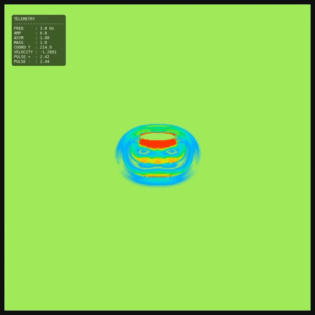

# Aeroacoustic Flying Saucer Oscillating Resonator CFD Simulation (LBM)

## Demo

  

This repository contains a Computational Fluid Dynamics (CFD) simulation application built with Python, NumPy, and Gradio. The application simulates the unsteady fluid dynamics and vortex generation produced by an asymmetric oscillating body (biomimetic resonator / "flying saucer" model) operating in a viscous medium, utilizing the **Lattice Boltzmann Method (D2Q9 model)**.

## Scientific Foundation & Engine Physics

The simulation is grounded in experimental and theoretical studies of asymmetric high-frequency oscillations of bodies in a viscous fluid.

### 1. Anomalous Aerodynamic Drag and Added Mass

The physical basis of the model is the phenomenon of anomalous increase of the drag coefficient under rapid oscillations, experimentally investigated by S.A. Gerasimov (2008). When a plate or an asymmetric body performs high-frequency oscillations, the effective drag coefficient $C_d$ rises to values of order $6.5$, whereas the steady-flow value in a wind tunnel is approximately $1.1$. This amplification is caused by the intense involvement of the fluid added mass.  

The present LBM implementation reproduces the essential consequence of this mechanism: the formation of a low-pressure cavity adjacent to the oscillating surface and the subsequent release of the stored energy as a directed impulse.

### 2. Directed Thrust by Medium Management

Directed propulsion arises without expulsion of mass. According to the conceptual framework and experimental work (on vibroplanes (Kandyba 2025) , an asymmetrically oscillating body organizes the surrounding fluid into coherent vortical structures.  

During the high-acceleration half-cycle the body separates the flow unevenly, producing toroidal vortex formations. These structures maintain a sustained pressure differential $\Delta P$ across the body. Net thrust is obtained by controlling the temporal and spatial asymmetry of the velocity profile (stroke acceleration bias and traveling-wave envelope). The numerical model realizes this principle through an energy-accumulation / collapse cycle that converts the work performed against the fluid into a directed force impulse at stroke reversal.

### 3. Model

Thrust generation is formulated as a barotropic collapse of a self-induced low-pressure cavity whose parameters are sampled directly from the LBM density field. The key feature of the model is the method of transferring the medium's momentum with a phase shift. The energy obtained from the grid does not act on the mask immediately, but accumulates as potential collapse energy. Various methods of calculating thrust are considered, such as drag inversion, baratropic collapse and bounce-back with the effect of added mass. This allows for a fairly realistic visualization of the experimentally observed phenomenon. 

### 4. Regime-Dependent Feedback

Environmental resistance modulates the oscillator parameters through a single accumulator. The feedback is decomposed into two physically distinct contributions that vary continuously with the kinematic regime:

- Temporal asymmetry (unequal duration of the power and recovery strokes) is proportional to the medusa-mode weight $w_{\perp}=1-w_{\mathrm{wave}}$ and therefore vanishes in pure traveling-wave (fish) mode.
- Spatial amplitude envelope (progressive increase of oscillation amplitude toward the trailing edge) is weighted toward the fish-mode coefficient $w_{\mathrm{wave}}$.

Frequency reduction under load remains common to both regimes. The decomposition prevents non-physical one-sided acceleration of the traveling wave while preserving the propulsive advantage of temporal asymmetry in the medusa regime.

### 5. Macroscopic Analogy

Within a broader theoretical interpretation the described mechanism is regarded as a macroscopic analogue of an elementary excitation interacting with a non-empty vacuum-like substrate. By continuous reorganization of boundary layers and vortex filaments the oscillating body modifies the geometry of the surrounding medium rather than expelling mass, thereby realizing a biomechanically inspired route toward advanced propulsion concepts.

---

## 📖 Bibliography & Research Materials

### Scientific Papers & Patents
* **Zenodo Publication (2025):** [Multimodal Aeroacoustic Aircraft Based on an Oscillating Resonator: From Laboratory Models to Quantum-Hydrodynamic Propulsion](https://doi.org/10.5281/zenodo.18047657)
* **Logos Online Journal (2021):** [Flying Saucer Experimental Research, Aerodynamics Unexplored Phenomenon and Bird's Flight](https://doi.org/10.36074/2663-4139.17.01)
* **Patent Reference:** Lozovsky L. (1998). *Method of vehicle movement and a universal "vibroplane" device for its implementation.* Patent RU 2147786 C1.

### Video Demonstrations & Experiments
* **Official YouTube Channel:** [Prometheus Aerospace (Experiments & Prototypes)](https://youtube.com/@prometheusaerospace505?si=OhGW_niCoRLgxGfs)

---

## 🛠️ App Features & Controls

The simulated Python application allows you to tweak the physical parameters of the fluid and the vehicle in real-time via a **Gradio Web UI**:

* **Fluid Properties:** Adjust grid relaxation time ($\tau$), modifying fluid viscosity and Reynolds number dynamics.
* **Object Mass:** Scale the inertia of the body to observe how it handles buoyancy vs. acceleration forces.
* **Dynamic Waveform Editor:** *Frequency (Hz)* & *Oscillation Amplitude* control the kinematics of the resonator.
  * *Velocity Profile Asymmetry* changes the stroke acceleration bias to optimize thrust generation.
* **Visualization Modes:** Toggle between Pressure, Pressure Deviation and Vorticity fields using a professional high-contrast multi-color CFD palette.

## Try it Online

You can try for free online:  
**[🛸🌊CFD Simulation](https://www.masterogon.art/index.php/flying-saucer-simulation/)**  

**[🛸🧑‍✈️Flight Simulator](https://www.masterogon.art/index.php/flying-saucer-simulator-2/)**  

**[🚬🧑‍✈️Flight Simulator](https://www.masterogon.art/index.php/ufo-cigar-flight-simulator/)**
